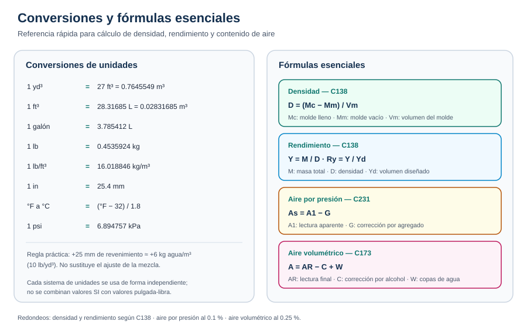

# Apéndice

Material de apoyo para consulta rápida durante el estudio y el trabajo en obra.

## A. Glosario (resumen)

Para no duplicar el glosario completo, aquí se listan solo los términos más consultados. El glosario ampliado, con más de 50 términos organizados por tema, está en **Recursos → Glosario**.

| Término | Definición breve |
| --- | --- |
| **Asentamiento (revenimiento)** | Descenso vertical del centro de la superficie al retirar el cono de Abrams. Mide consistencia, no trabajabilidad. |
| **Muestra compuesta** | Combinación de dos o más porciones tomadas de la misma amasada entre el 10 % y el 90 % de la descarga, dentro de 15 min. |
| **Densidad (peso unitario)** | Masa por unidad de volumen del concreto fresco: D = (Mc − Mm) / Vm. |
| **Rendimiento relativo (Ry)** | Relación entre el volumen real producido y el volumen diseñado. |
| **Factor de corrección por agregado (G)** | Corrección del método de presión por el aire atrapado en los poros del agregado. |
| **Contenido de aire** | Volumen de vacíos de aire, expresado como porcentaje del volumen total. |
| **NMAS** | Tamaño máximo nominal del agregado: tamiz inmediatamente superior al mayor tamaño presente en cantidad significativa. |
| **Trazabilidad** | Capacidad de reconstruir la historia de un resultado a partir de registros completos. |

> **Glosario completo:** consulta **Recursos → Glosario** para la lista ampliada de términos técnicos, metrología y normas.

## B. Factores de conversión

| De | A | Multiplicar por |
| --- | --- | --- |
| yarda cúbica (yd³) | pie cúbico (ft³) | 27 |
| yarda cúbica (yd³) | metro cúbico (m³) | 0.7645549 |
| pie cúbico (ft³) | metro cúbico (m³) | 0.02831685 |
| pie cúbico (ft³) | litro (L) | 28.31685 |
| galón (gal) | litro (L) | 3.785412 |
| libra (lb) | kilogramo (kg) | 0.4535924 |
| lb/ft³ | kg/m³ | 16.018846 |
| pulgada (in) | milímetro (mm) | 25.4 |
| °F | °C | (°F − 32) / 1.8 |

> **Conversión rápida:** para calcular conversiones de longitud, masa, volumen y esfuerzo, usa **Recursos → Calculadoras**.

**Regla práctica:** para aumentar el revenimiento en 25 mm (1 in) se agregan aproximadamente 6 kg de agua por m³ (10 lb por yd³) de concreto. Esta regla **no** sustituye el ajuste de la mezcla por el responsable técnico.

## C. Fórmulas esenciales

> **Cálculo rápido:** para resolver densidad, rendimiento, aire, resistencia, temperatura y conversiones, usa **Recursos → Calculadoras**.

### Densidad y rendimiento (ASTM C138)

- Densidad: **D = (Mc − Mm) / Vm**
- Densidad teórica: **T = M / V**
- Rendimiento: **Y = M / D** (m³) o **Y = M / (D × 27)** (yd³)
- Rendimiento relativo: **Ry = Y / Yd**
- Contenido de cemento: **C = Cb / Y**
- Contenido de aire gravimétrico: **A = [(T − D) / T] × 100**

Donde *Mc* es la masa del molde lleno, *Mm* la masa del molde vacío, *Vm* el volumen del molde, *M* la masa total de materiales y *Yd* el volumen diseñado.

### Contenido de aire por presión (ASTM C231)

- Contenido aparente: **A1 = h1 − h2** (medidor Tipo A) o lectura del dial (Tipo B)
- Contenido real: **As = A1 − G**

### Contenido de aire volumétrico (ASTM C173)

- **A = AR − C + W**

Donde *AR* es la lectura final del medidor, *C* el factor de corrección por alcohol y *W* el número de copas calibradas de agua agregadas.

### Mezcla completa a partir de la fracción tamizada (ASTM C231)

- **At = 100 · As · Vc / (100 · Vt − As · Va)**

## D. Referencias cruzadas ASTM / AASHTO / CSA

| ASTM | AASHTO | CSA | Tema |
| --- | --- | --- | --- |
| C29 | T 19 | A23.2-10A | Densidad y vacíos del agregado |
| C31 | T 23 | A23.2-3C | Elaboración y curado de especímenes en campo |
| C94 | M 157 | A23.1-M | Concreto premezclado |
| C138 | T 121 | A23.2-6C | Densidad, rendimiento y aire gravimétrico |
| C143 | T 119 | A23.2-5C | Asentamiento |
| C172 | T 141 | A23.2-1C | Muestreo de concreto fresco |
| C173 | T 196 | A23.2-7C | Contenido de aire volumétrico |
| C231 | T 152 | A23.2-4C | Contenido de aire por presión |
| C1064 | — | A23.2-17C | Temperatura del concreto fresco |

> Para el programa de certificación ACI, **ASTM es la referencia estándar** para las preguntas del examen. Las equivalencias AASHTO y CSA son orientativas y pueden presentar diferencias de detalle.

## E. Preguntas de repaso

Para no mantener dos bancos de preguntas paralelos, las preguntas de repaso se concentran en dos lugares:

- **Cada sección** incluye una lista de preguntas de repaso en su pestaña **Ensayos**.
- **Recursos → Autoevaluación** ofrece 21 preguntas interactivas con calificación, retroalimentación y mejor puntaje guardado.

> Si buscas preguntas rápidas por tema, usa la pestaña **Ensayos** de la sección correspondiente; si quieres una evaluación global, usa la **Autoevaluación**.

## F. Referencias bibliográficas

- ASTM C31/C31M — *Practice for Making and Curing Concrete Test Specimens in the Field*.
- ASTM C138/C138M — *Test Method for Density (Unit Weight), Yield, and Air Content (Gravimetric) of Concrete*.
- ASTM C143/C143M — *Test Method for Slump of Hydraulic-Cement Concrete*.
- ASTM C172/C172M — *Practice for Sampling Freshly Mixed Concrete*.
- ASTM C173/C173M — *Test Method for Air Content of Freshly Mixed Concrete by the Volumetric Method*.
- ASTM C231/C231M — *Test Method for Air Content of Freshly Mixed Concrete by the Pressure Method*.
- ASTM C1064/C1064M — *Test Method for Temperature of Freshly Mixed Hydraulic-Cement Concrete*.
- ACI 301 — *Specifications for Concrete Construction*.
- ACI 318 — *Building Code Requirements for Structural Concrete*.
- ACI 309R — *Guide for Consolidation of Concrete*.
- NMX-C-160, NMX-C-161, NMX-C-162, NMX-C-156, NMX-C-157, NMX-C-158, NMX-C-435 — normas mexicanas equivalentes.

## G. Registro de calibraciones

La bitácora completa de verificación y calibración, con frecuencias, criterios y lista de verificación por equipo, está en **Recursos → Equipo y calibración**.

> Usa esa bitácora para registrar identificación, fecha, patrón, resultado, próxima fecha, responsable y aceptación. Así se evita mantener dos formatos paralelos.
