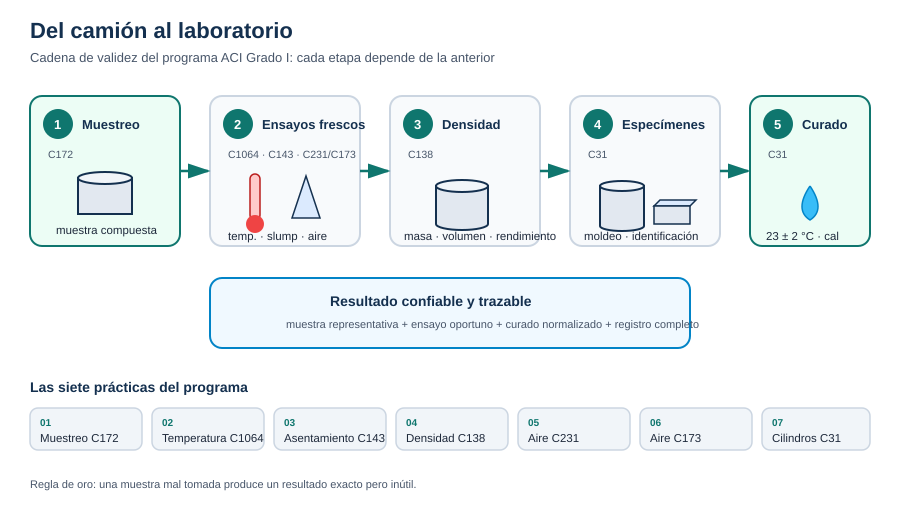

# Introducción

El programa de certificación del **American Concrete Institute (ACI)** para **Técnico para Pruebas al Concreto en la Obra — Grado I** tiene como propósito certificar a los técnicos que demuestran el conocimiento y la habilidad necesarios para ejecutar correctamente las pruebas básicas de campo al concreto recién mezclado.

Este manual corresponde al técnico **CP-1S(15)** y reúne, en un solo documento de consulta, la normativa, los procedimientos y los criterios de aceptación de las siete prácticas que forman el núcleo del programa. No sustituye a las normas ASTM: las resume y las ordena para facilitar el estudio y la aplicación en obra.

## ¿Qué hace un técnico ACI Grado I?

Un técnico Grado I puede realizar, bajo supervisión y con equipo calibrado, las siguientes actividades:

- Obtener muestras representativas de concreto fresco conforme a **ASTM C172**.
- Medir la temperatura de la mezcla conforme a **ASTM C1064**.
- Determinar el asentamiento (revenimiento) conforme a **ASTM C143**.
- Determinar la densidad, el rendimiento y el contenido de aire gravimétrico conforme a **ASTM C138**.
- Determinar el contenido de aire por presión conforme a **ASTM C231**.
- Determinar el contenido de aire por el método volumétrico conforme a **ASTM C173**.
- Moldear, identificar, curar, proteger y transportar cilindros y vigas conforme a **ASTM C31**.

El técnico Grado I **no** realiza ensayos de resistencia en laboratorio, pruebas de fluidez, ensayos de agregados ni interpretaciones estructurales; esas actividades corresponden a otros niveles de certificación o al laboratorio responsable.

## Cómo está organizado el manual

El contenido se divide en dos grandes bloques, tal como los agrupa el programa:

| Bloque | Secciones | Contenido |
| --- | --- | --- |
| Análisis de tarea del trabajo | 1 a 4 | Muestreo, temperatura, asentamiento, densidad y rendimiento |
| Contenido de aire y especímenes | 5 a 7 | Aire por presión, aire volumétrico, cilindros y vigas |

Cada sección tiene tres pestañas:

- **Normativa** — alcance de la norma, documentos de referencia, requisitos, tolerancias y precisión.
- **Procedimientos** — secuencia paso a paso, equipo, tiempos y verificaciones.
- **Ensayos** — criterios de aceptación, errores frecuentes, ejemplos numéricos y formatos de registro.

Además, cada sección incluye una lista de verificación de desempeño que puedes marcar en pantalla. Esa lista reproduce la secuencia que se evalúa en el examen práctico del ACI.

## La cadena de validez

Un resultado solo es confiable si toda la cadena lo es. El orden importa:

1. **Muestreo representativo.** Si la muestra no representa la amasada, ningún ensayo posterior corrige el error.
2. **Ensayos dentro del tiempo.** El concreto cambia con los minutos: temperatura, asentamiento y aire deben iniciarse dentro de los 5 minutos posteriores a la muestra compuesta.
3. **Equipo calibrado y limpio.** Conos, recipientes, medidores de aire, termómetros y balanzas deben verificarse.
4. **Moldeo y curado normalizados.** La resistencia depende tanto del moldeo como del curado.
5. **Registro completo.** Sin identificación, hora, norma y condiciones, el dato no es trazable.

> **Regla de oro:** una muestra mal tomada produce un resultado exacto pero inútil.

## Seguridad e higiene

Las mezclas hidráulicas frescas son **cáusticas**. Usa guantes, lentes de protección y calzado cerrado. Evita el contacto prolongado con la piel y lava las zonas expuestas con abundante agua. El alcohol isopropílico es inflamable: mantenlo alejado de fuentes de ignición y usa ventilación adecuada. Levanta los moldes y recipientes con la técnica correcta para evitar lesiones lumbares.

## Cómo estudiar este manual

1. Lee primero la pestaña **Normativa** de cada sección para entender el alcance y los límites del ensayo.
2. Practica la secuencia de **Procedimientos** con el equipo real, cronometrando cada paso.
3. Revisa **Ensayos** para conocer los criterios de rechazo y los cálculos.
4. Marca la lista de verificación solo cuando hayas ejecutado el paso correctamente.
5. Consulta el **Apéndice** para el glosario, las conversiones y las referencias cruzadas ASTM/AASHTO/CSA.

La certificación se obtiene al aprobar el examen escrito y el examen de desempeño. Este manual te prepara para ambos, pero la habilidad se demuestra con las manos y con el cumplimiento riguroso de la norma.
