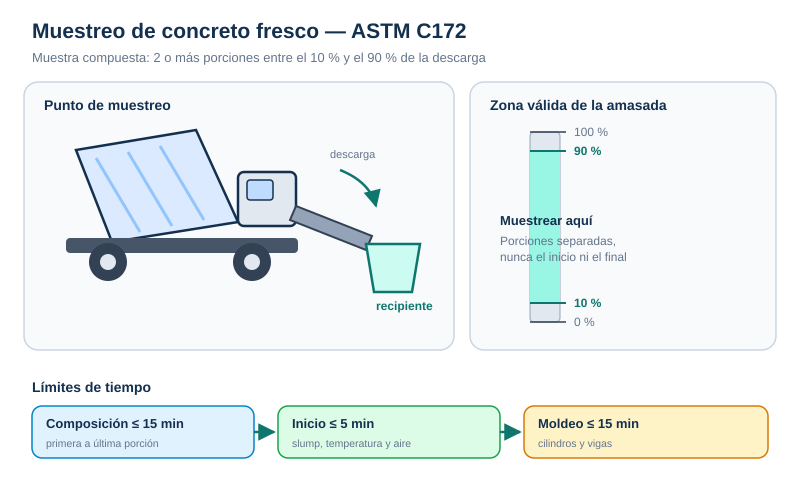

# Procedimientos — Muestreo

## 1. Preparación

1. Revisa la orden de trabajo: elemento, amasada, volumen colado y ensayos solicitados.
2. Verifica que el camión haya completado el mezclado y que **toda el agua y los aditivos** estén incorporados.
3. Prepara un recipiente limpio, seco o humedecido, **no absorbente**, de capacidad suficiente (mínimo 28 L para resistencia).
4. Ten a mano pala o cucharón, guantes, cronómetro, termómetro, cono y medidor de aire.
5. Identifica un lugar plano, limpio y protegido para componer y remezclar la muestra.

## 2. Selección del punto de muestreo

| Condición | Punto correcto |
| --- | --- |
| Camión mezclador | Descarga del canalón, en la porción media de la amasada |
| Bomba de concreto | Descarga de la bomba, si la especificación lo exige |
| Mezcladora estacionaria | Flujo de descarga, atravesándolo con el recipiente |
| Pavimentación | Pila descargada, tomando 5 porciones distintas |
| Mezclador continuo | Después de 140 L y de los ajustes de mezcla |

## 3. Toma de porciones

1. **Descarta** el concreto inicial. No tomes muestra antes de que se haya descargado el **10 %**.
2. Toma la primera porción pasando el recipiente a través de todo el flujo de descarga, o desviando la descarga completa a un recipiente de muestreo.
3. Toma una **segunda porción** a un intervalo regular, avanzada la descarga.
4. Si el volumen lo requiere, toma porciones adicionales, siempre dentro de la zona media.
5. **No muestrees** el último **10 %** de la descarga.
6. Regula la velocidad de descarga con la revolución del tambor; no cierres la abertura para “controlar” el flujo, porque produces segregación.
7. Registra la hora de la primera porción.

## 4. Composición y remezcla

1. Lleva las porciones al lugar de ensayo.
2. Combínalas en el recipiente limpio y no absorbente.
3. Remezcla con pala **lo mínimo necesario** para asegurar uniformidad; un exceso de manipulación incorpora aire y altera el contenido de aire.
4. Registra la hora de la última porción. La diferencia con la primera **no debe exceder 15 min**.
5. Protege la muestra del sol, viento, lluvia y contaminación.

## 5. Secuencia de ensayos

La norma fija una carrera contra el reloj:

| Tiempo | Acción |
| --- | --- |
| 0 min | Última porción de la muestra compuesta |
| ≤ 5 min | Iniciar asentamiento, temperatura y contenido de aire |
| ≤ 15 min | Iniciar el moldeo de especímenes de resistencia |

Realiza los ensayos de forma expedita, sin interrupciones innecesarias. Si el volumen de trabajo es grande, organiza un equipo: una persona mide temperatura mientras otra prepara el cono.

## 6. Tamizado húmedo (si aplica)

1. Selecciona el tamiz según el tamaño del molde o equipo.
2. Humedece el tamiz y el recipiente receptor.
3. Coloca capas delgadas de concreto sobre el tamiz.
4. Sacude manual o mecánicamente hasta que no pase más mortero.
5. Descarta el agregado retenido; no le quites el mortero adherido.
6. Raspa el mortero de los bordes del tamiz hacia la mezcla.
7. Remezcla y ensaya inmediatamente.

## 7. Errores frecuentes

- Muestrear el primer concreto que sale del camión.
- Tomar una sola porción y llamarla “muestra compuesta”.
- Dejar la muestra al sol o al viento mientras se prepara el equipo.
- Agregar agua a la muestra para “facilitar” el ensayo.
- Reutilizar concreto que ya se usó para el ensayo de aire.
- Exceder los 15 min de composición o los 5 min para iniciar ensayos.
- No registrar la hora ni el punto de muestreo.

## 8. Registro mínimo

| Dato | Ejemplo |
| --- | --- |
| Obra / elemento | Losa nivel 2, eje B-3 |
| Camión / amasada | 214 / 08:42 |
| Hora primera porción | 09:05 |
| Hora última porción | 09:12 |
| Volumen de muestra | 30 L |
| Condiciones | Soleado, 28 °C, viento moderado |
| Responsable | Técnico ACI |
