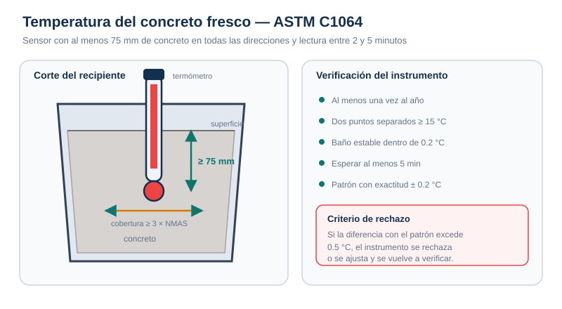

# Procedimientos — Temperatura

## 1. Antes de medir

1. Confirma que el termómetro tiene verificación vigente (máximo 12 meses).
2. Limpia el vástago y el sensor; elimina residuos de concreto o grasa.
3. Verifica la batería y que la pantalla encienda correctamente.
4. Si vas a usar un recipiente, humedécelo con agua y elimina el exceso.
5. Ten lista la ficha de registro con hora, amasada y elemento.

## 2. Medición en el equipo de transporte o en la forma

1. Identifica un punto representativo, lejos de las paredes del camión o del molde.
2. Introduce el sensor **al menos 75 mm** en el concreto.
3. Asegura que haya concreto en todas las direcciones alrededor del sensor.
4. Presiona suavemente el concreto alrededor del vástago para cerrar el hueco.
5. Mantén el dispositivo inmóvil y protegido del sol directo.
6. Espera **2 min como mínimo y 5 min como máximo**.
7. Lee la temperatura **sin retirar** el dispositivo.
8. Registra el valor al **0.5 °C** más cercano.

## 3. Medición en recipiente independiente

1. Humedece el recipiente antes de muestrear.
2. Toma la muestra conforme a **C172** (no se requiere muestra compuesta si solo se mide temperatura).
3. Coloca el concreto en el recipiente, dejando suficiente cobertura alrededor del sensor.
4. Repite los pasos 2 a 8 de la sección anterior.
5. Tapa o protege la muestra si aún se usarán otros ensayos.

## 4. Secuencia recomendada

| Paso | Tiempo | Acción |
| --- | --- | --- |
| 1 | 0 min | Insertar el sensor a ≥75 mm |
| 2 | 0–2 min | Esperar estabilización; preparar el resto del equipo |
| 3 | 2–5 min | Leer y registrar |
| 4 | ≤5 min | Iniciar slump y contenido de aire |

La temperatura suele medirse primero porque es el ensayo más rápido y no consume muestra. Sin embargo, no debe retrasar el inicio del slump ni del aire más allá de los 5 min.

## 5. Verificación anual del instrumento

1. Prepara un baño de aceite o líquido con circulación.
2. Ajusta dos puntos de prueba separados al menos 15 °C.
3. Sumerge el termómetro patrón y el termómetro a verificar sin tocar paredes.
4. Espera al menos 5 min en cada punto.
5. Compara las lecturas.
6. Si la diferencia es **mayor de 0.5 °C**, rechaza o ajusta el instrumento y vuelve a verificar.
7. Documenta fecha, identificaciones, lecturas y responsable.

## 6. Errores frecuentes

- Medir en la superficie del concreto, con el sensor parcialmente expuesto al aire.
- Retirar el termómetro antes de los 2 min.
- Dejar el termómetro más de 5 min y registrar una lectura ya afectada por el ambiente.
- Medir junto a la pared metálica del camión o del molde.
- Usar un termómetro sin verificación vigente.
- Registrar “28 °C” cuando el instrumento indica 28.3 °C; el redondeo correcto es 28.5 °C.
- No registrar la hora ni las condiciones ambientales.

## 7. Registro mínimo

| Dato | Ejemplo |
| --- | --- |
| Obra / elemento | Muro de contención, tramo 3 |
| Camión / amasada | 118 / 10:15 |
| Hora de lectura | 10:22 |
| Temperatura | 29.5 °C |
| Dispositivo / ID | Termómetro digital TD-04 |
| Verificación vigente | 2026-03-15 |
| Límite del proyecto | ≤ 32 °C |
| Responsable | Técnico ACI |
