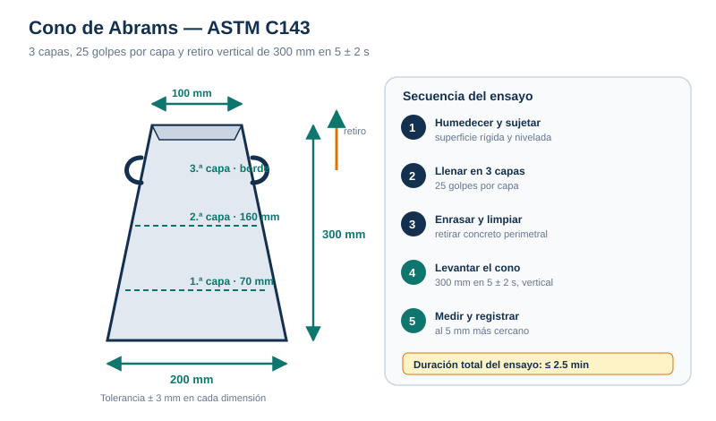

# Procedimientos — Asentamiento

## 1. Preparación

1. Verifica que el cono esté limpio, sin mortero adherido ni deformaciones.
2. Comprueba las dimensiones si no hay registro del año: base 200 mm, superior 100 mm, altura 300 mm.
3. Humedece el cono y la placa base; elimina el agua libre con un trapo.
4. Coloca la placa sobre una superficie rígida, plana, nivelada, húmeda, no absorbente y libre de vibraciones.
5. Sujeta el cono firmemente: pisa las aletas o usa la placa con grapas.
6. Ten lista la varilla de 16 mm, la regla y el cronómetro.
7. Inicia el cronómetro al comenzar el llenado.

## 2. Llenado y compactación

| Capa | Profundidad aproximada | Golpes | Penetración |
| --- | --- | --- | --- |
| 1 | 70 mm (2⅝ in) | 25 | Toda la capa, sin dañar la base |
| 2 | 160 mm (6⅛ in) | 25 | 25 mm en la capa anterior |
| 3 | Hasta rebosar | 25 | 25 mm en la capa anterior |

1. Coloca el concreto con el cucharón moviéndolo alrededor del perímetro para distribuir sin segregar.
2. Compacta la primera capa con 25 golpes: inclina ligeramente la varilla, comienza cerca del perímetro y avanza en espiral hacia el centro.
3. Llena la segunda capa hasta ~160 mm y compacta con 25 golpes, penetrando 25 mm en la primera.
4. Llena la tercera capa hasta rebosar y compacta con 25 golpes, penetrando 25 mm en la segunda.
5. Si el concreto baja del borde durante el varillado, agrega más concreto y continúa el conteo.
6. Enrasa con un movimiento de regleado y rodado de la varilla.

## 3. Retiro del cono y medición

1. Limpia el concreto que rodea la base, sin golpear el cono.
2. Sujeta el cono y levántalo **verticalmente 300 mm en 5 ± 2 s**, sin girar ni inclinar.
3. Coloca el cono invertido junto a la muestra, como referencia.
4. Mide inmediatamente la diferencia vertical entre la parte superior del cono y el centro desplazado de la superficie.
5. Registra el valor al **5 mm** más cercano.
6. Observa y describe el tipo de falla.

> El ensayo completo, desde el inicio del llenado hasta retirar el molde, debe durar **2.5 min como máximo**. Si se excede, se descarta y se repite.

## 4. Tipos de falla

| Falla | Descripción | Acción |
| --- | --- | --- |
| Normal | La masa desciende uniformemente y conserva simetría | Válida |
| Cortante | Una parte de la masa se desliza lateralmente | Descartar y repetir |
| Colapso | La masa se derrumba o se separa | Descartar y repetir |

Si dos ensayos consecutivos presentan cortante o colapso, probablemente el concreto no es plástico ni cohesivo; el ensayo de asentamiento puede no ser aplicable.

## 5. Errores frecuentes

- No humedecer el cono o dejar charcos en la base.
- Llenar en dos capas o dar menos de 25 golpes.
- Golpear el cono con la varilla después del enrasado.
- Levantar el cono en más de 7 s o con movimiento lateral.
- Medir desde un punto que no es el centro original desplazado.
- Redondear a 10 mm en lugar de 5 mm.
- Exceder los 2.5 min y aun así reportar el resultado.

## 6. Registro mínimo

| Dato | Ejemplo |
| --- | --- |
| Obra / elemento | Losa de cimentación, eje C-2 |
| Camión / amasada | 307 / 11:20 |
| Hora del ensayo | 11:26 |
| Asentamiento | 125 mm |
| Tipo de falla | Normal |
| Temperatura | 30.0 °C |
| Observaciones | Mezcla cohesiva, sin segregación |
| Responsable | Técnico ACI |
