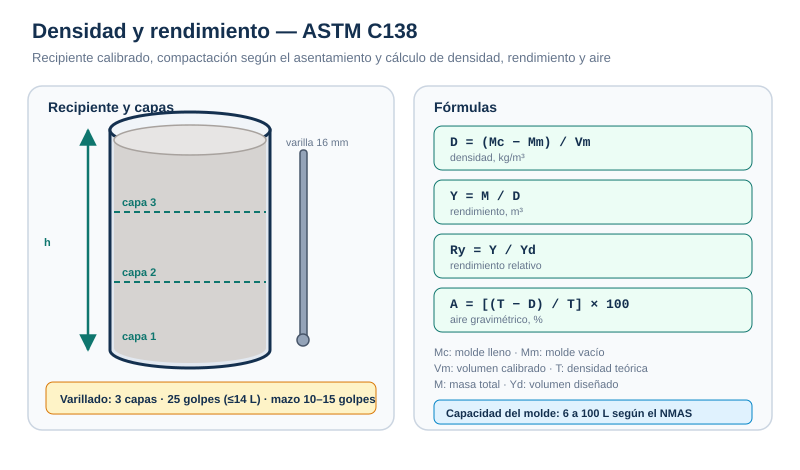

# Procedimientos — Densidad y rendimiento

## 1. Calibración del volumen del recipiente

1. Limpia y seca el recipiente.
2. Pesa el recipiente vacío y registra **Mm**.
3. Llena el recipiente con agua a temperatura ambiente hasta el borde.
4. Desliza una placa de vidrio para eliminar el exceso y las burbujas.
5. Pesa el recipiente lleno de agua.
6. Calcula el volumen: **Vm = (masa de agua) / (densidad del agua a la temperatura)**.
7. Registra el volumen al **0.01 L** más cercano.
8. Repite la calibración si el recipiente se golpea, deforma o repara.

## 2. Preparación de la muestra

1. Obtén la muestra conforme a **C172**.
2. Humedece el interior del recipiente y elimina el agua estancada.
3. Coloca el recipiente sobre una superficie plana, nivelada y firme.
4. Determina la masa del recipiente vacío.
5. Mide el asentamiento para seleccionar el método de compactación.

## 3. Llenado y compactación

### Varillado (slump >75 mm; o 25–75 mm si se elige)

1. Llena en **3 capas** de volumen aproximadamente igual.
2. Mueve el cucharón alrededor del perímetro para distribuir sin segregar.
3. Compacta cada capa con **25 golpes** (moldes ≤14 L), **50 golpes** (28 L) o **1 golpe/20 cm²** (mayores).
4. Penetra 25 mm en la capa anterior.
5. Golpea los costados **10 a 15 veces** con el mazo después de cada capa.
6. Ajusta la última capa para evitar sobrellenado.

### Vibración (slump <25 mm; o 25–75 mm si se elige)

1. Llena en **2 capas** de igual volumen.
2. Coloca todo el concreto de la capa antes de vibrar.
3. Inserta el vibrador en **3 puntos** por capa, sin tocar fondo ni paredes.
4. Penetra 25 mm en la capa anterior.
5. Vibra hasta que la superficie esté relativamente lisa; evita la sobrevibración.

## 4. Enrasado y pesaje

1. Retira el exceso de concreto con llana o cucharón.
2. Enrasa con la placa: cubre dos tercios, retira con movimiento de sierra, vuelve a colocar y avanza hasta cubrir toda la superficie.
3. Limpia completamente el exterior del recipiente.
4. Pesa el recipiente lleno y registra **Mc**.
5. Calcula la densidad y los parámetros solicitados.

## 5. Cálculos

| Parámetro | Fórmula | Unidad |
| --- | --- | --- |
| Densidad | D = (Mc − Mm) / Vm | kg/m³ |
| Densidad teórica | T = M / V | kg/m³ |
| Rendimiento | Y = M / D | m³ |
| Rendimiento relativo | Ry = Y / Yd | adimensional |
| Contenido de cemento | C = Cb / Y | kg/m³ |
| Aire gravimétrico | A = [(T − D) / T] × 100 | % |

## 6. Errores frecuentes

- Usar un recipiente cuya capacidad no corresponde al NMAS.
- No calibrar el volumen o usar un volumen nominal en lugar del real.
- Compactar con el método incorrecto para el slump.
- Dar menos golpes o no golpear los costados.
- Enrasar con el recipiente inclinado o con exceso de concreto.
- No limpiar el exterior antes de pesar.
- Confundir densidad con densidad teórica.
- Reportar el rendimiento sin indicar si es absoluto o relativo.

## 7. Registro mínimo

| Dato | Ejemplo |
| --- | --- |
| Obra / elemento | Columna C-4 |
| Camión / amasada | 512 / 15:10 |
| Volumen del molde | 14.27 L |
| Masa del molde vacío | 8.89 kg |
| Masa del molde lleno | 41.78 kg |
| Asentamiento | 110 mm |
| Método de compactación | Varillado |
| Densidad | 2305 kg/m³ |
| Responsable | Técnico ACI |
