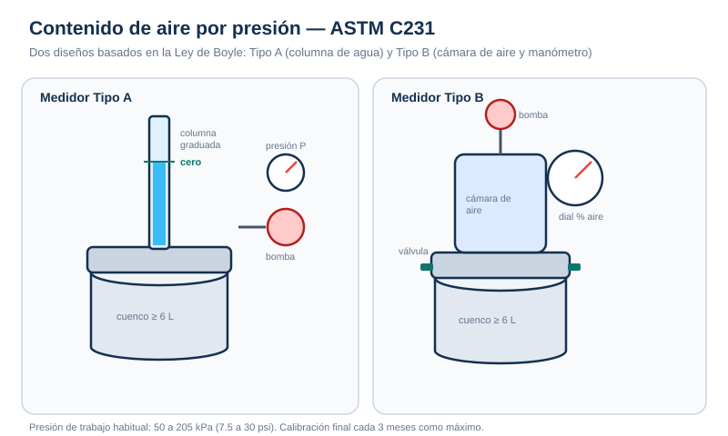

# Procedimientos — Aire por presión

## 1. Preparación general

1. Verifica la calibración vigente (máximo 3 meses).
2. Limpia el cuenco, la tapa y las bridas; elimina restos de concreto y grasa.
3. Humedece el interior del cuenco y elimina el agua estancada.
4. Obtén la muestra conforme a **C172**.
5. Si el concreto contiene agregado retenido en 50 mm (2 in), tamiza en húmedo por 37.5 mm (1½ in) conforme a C172.
6. Mide el asentamiento para elegir el método de compactación.

## 2. Llenado y compactación

| Asentamiento | Método |
| --- | --- |
| > 75 mm | Varillado: 3 capas, 25 golpes por capa, mazo 10–15 golpes |
| 25–75 mm | Varillado o vibración |
| < 25 mm | Vibración: 2 capas, 3 inserciones por capa |

1. Coloca el concreto con cucharón alrededor del perímetro para evitar segregación.
2. Compacta cada capa; en las superiores penetra 25 mm en la anterior.
3. Enrasa deslizando la barra por el borde del cuenco; retira el exceso.
4. Limpia las bridas del cuenco y de la tapa para asegurar el sello.

## 3. Medidor Tipo A

1. Llena la columna de agua hasta la marca indicada, inclinando el aparato unos 30° y golpeando suavemente la tapa para eliminar burbujas.
2. Vuelve a la vertical y ajusta el nivel exactamente a la marca cero.
3. Cierra el respiradero superior.
4. Aplica una presión ligeramente superior a P (aproximadamente 1.4 kPa más) con la bomba de mano.
5. Golpea bruscamente los costados del cuenco para liberar restricciones locales.
6. Cuando el manómetro indique exactamente P, lee el nivel de agua **h1**.
7. Libera gradualmente la presión por el respiradero, golpeando suavemente durante ~1 min.
8. Lee el nivel de agua **h2** a presión cero.
9. Calcula **A1 = h1 − h2**.
10. Repite sin agregar agua: dos determinaciones consecutivas deben diferir en **≤0.2 %**; promedia el resultado.

> Si el contenido de aire excede el rango del medidor, usa la presión alternativa P1 y repite.

## 4. Medidor Tipo B

1. Limpia y ensambla el aparato.
2. Cierra la válvula principal entre la cámara de aire y el cuenco.
3. Abre ambas llaves de purga.
4. Inyecta agua con jeringa hasta que emerja por la llave opuesta; sacude para expulsar el aire.
5. Cierra la llave de purga de la cámara de aire.
6. Bombea aire hasta la línea de presión inicial.
7. Deja enfriar unos segundos y estabiliza el índice en la línea.
8. Cierra ambas llaves de purga de la tapa.
9. Abre la válvula principal entre la cámara y el cuenco.
10. Golpea vigorosamente los costados del cuenco y suavemente el manómetro.
11. Lee el porcentaje de aire en el dial.
12. Cierra la válvula principal **antes** de liberar la presión.
13. Libera la presión por ambas llaves de purga antes de retirar la tapa.

## 5. Determinación del factor G

1. Calcula las masas de agregado fino y grueso de la muestra.
2. Coloca agua hasta un tercio del cuenco.
3. Agrega el agregado combinado poco a poco, eliminando espuma.
4. Golpea los costados y varilla los 25 mm superiores 8–12 veces.
5. Mantén inundado el agregado el tiempo equivalente al de la mezcla.
6. Completa el ensayo como con el concreto.
7. Registra G.

## 6. Cálculo y reporte

- **As = A1 − G**
- Reporta al **0.1 %** más cercano.
- Registra fecha, hora, tipo de medidor, calibración, G y cualquier desviación.

## 7. Errores frecuentes

- Usar el medidor con agregado ligero o poroso.
- Calibración vencida o presión P incorrecta.
- Bridas sucias o sello deficiente: fuga de aire o agua.
- No eliminar burbujas antes de la lectura.
- No aplicar el factor G.
- Golpear demasiado fuerte y provocar pérdida de aire incorporado.
- Abrir la tapa antes de liberar la presión.
