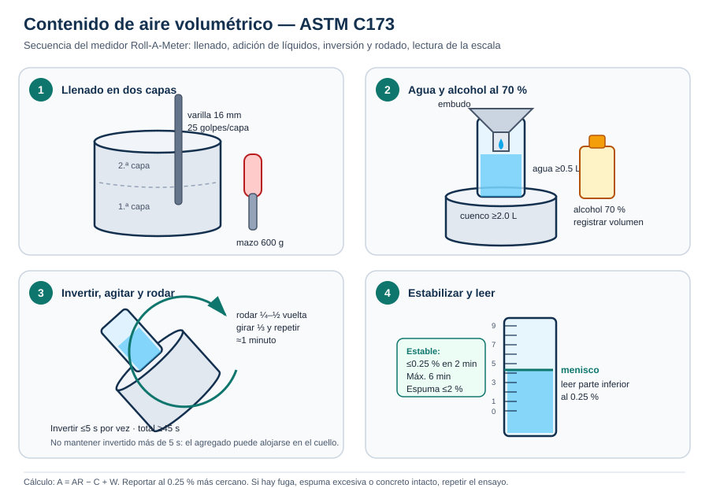

# Procedimientos — Aire volumétrico (Roll-A-Meter)

## 1. Preparación

1. Verifica que el medidor y la copa calibrada tengan calibración vigente (máximo un año).
2. Limpia el cuenco, la sección superior, la junta y la tapa; elimina restos de concreto endurecido.
3. Humedece el interior del cuenco hasta que se vea húmedo pero **no brillante**; elimina el agua estancada.
4. Obtén la muestra conforme a **ASTM C172**. Si hay agregado retenido en 37.5 mm, tamiza en húmedo por 25 mm.
5. Ten a la mano: varilla de 16 mm, mazo de 600 g, barra de enrasado, embudo, jeringa, vaso graduado, alcohol al 70 % y copa calibrada.
6. Registra la cantidad de alcohol que vas a usar antes de comenzar.

## 2. Llenado y compactación

1. Con la cuchara, coloca concreto en el cuenco en **dos capas de aproximadamente el mismo volumen**, moviendo la cuchara alrededor del perímetro para evitar segregación.
2. Compacta la primera capa con **25 golpes** distribuidos uniformemente, atravesando todo su espesor y sin dañar el fondo.
3. Golpea las paredes del cuenco **10 a 15 veces** con el mazo para cerrar huecos y liberar burbujas grandes.
4. Llena la segunda capa y repite: 25 golpes, penetrando unos **25 mm** en la capa inferior, y 10 a 15 golpes de mazo.
5. Se acepta un ligero exceso de concreto de **3 mm o menos** sobre el borde. Agrega o retira concreto representativo si es necesario.
6. Enrasa con la barra hasta que la superficie quede al nivel del borde superior y limpia la brida del cuenco.

> **No reutilices** el concreto de otros ensayos. La muestra para el medidor volumétrico debe ser fresca y representativa.

## 3. Montaje y llenado con líquidos

1. Humedece el interior de la sección superior, incluida la junta.
2. Acopla la sección superior al cuenco y verifica que el sello sea hermético.
3. Inserta el embudo por el cuello.
4. Agrega **al menos 0.5 L (1 pt) de agua**.
5. Agrega la cantidad seleccionada de **alcohol isopropílico al 70 %** y registra el volumen exacto.
6. Continúa agregando agua hasta que aparezca en el cuello graduado.
7. Retira el embudo y ajusta el nivel con la jeringa hasta que la **parte inferior del menisco** quede en la marca cero.
8. Coloca la tapa y apriétala firmemente. Verifica que no haya fugas.

> El alcohol solo se agrega en este momento. **Nunca** lo añadas después para bajar la espuma: si la espuma excede 2 %, el ensayo se repite con más alcohol desde el inicio.

## 4. Inversión y agitado

1. Invierte rápidamente el medidor, agita el cuenco horizontalmente y vuelve a la posición vertical.
2. **No mantengas el medidor invertido más de 5 segundos** por vez, para evitar que el agregado se aloje en el cuello.
3. Repite la inversión y el agitado durante **un mínimo de 45 segundos**, hasta que el concreto se libere y se escuche el agregado deslizarse.
4. Si en cualquier momento detectas fuga de líquido, declara inválido el ensayo y comienza de nuevo con una muestra fresca.

## 5. Rodado

1. Coloca una mano en el cuello y otra en la brida.
2. Inclina la parte superior del medidor aproximadamente **45° (0.8 rad)** respecto a la vertical, apoyando el borde inferior del cuenco en el piso o en la superficie de trabajo.
3. Con la mano en la brida, rueda vigorosamente el medidor de **¼ a ½ vuelta** hacia adelante y hacia atrás varias veces, comenzando y deteniendo el movimiento con rapidez.
4. Gira el cuenco aproximadamente **⅓ de vuelta** y repite el rodado.
5. Continúa los giros y el rodado durante **aproximadamente 1 minuto**. Debes escuchar el agregado deslizándose.

## 6. Estabilización y lectura

1. Coloca el medidor en posición vertical y afloja la tapa para permitir que la presión se estabilice.
2. Espera a que el aire suba y el nivel del líquido se estabilice. Se considera estable cuando **no cambia más de 0.25 % en 2 minutos**.
3. Si el nivel no se estabiliza dentro de **6 minutos**, descarta el ensayo y repite con más alcohol.
4. Si hay espuma equivalente a más de **2 % de aire** sobre el líquido, descarta el ensayo y repite con más alcohol.
5. Lee la **parte inferior del menisco** al **0.25 %** más cercano. Esta es la lectura inicial.
6. Si el contenido de aire supera el rango de 9 %, agrega copas calibradas de agua hasta llevar el nivel dentro de la escala. Anota cuántas copas agregaste (**W**).
7. Cierra la tapa y repite el rodado durante 1 minuto; estabiliza y toma una segunda lectura.
8. Si la segunda lectura difiere **≤0.25 %** de la primera, regístrala como lectura final (**AR**).
9. Si difiere más de 0.25 %, toma esa lectura como nueva lectura inicial y repite el rodado. Si la tercera lectura tampoco coincide dentro de 0.25 %, descarta el ensayo y comienza con una muestra nueva y más alcohol.

## 7. Desmontaje y verificación

1. Separa la sección superior del cuenco.
2. Deja escurrir el líquido y vacía el contenido del cuenco.
3. Examina el interior: si quedan **porciones de concreto intactas o mal compactadas**, el ensayo no es válido.
4. Lava y seca el equipo; no dejes residuos de cemento en la junta ni en el cuello.

## 8. Cálculo y reporte

1. Redondea el volumen de alcohol al **0.5 L** más cercano si usaste más de 1.25 L.
2. Toma el factor **C** de la Tabla 1.
3. Calcula **A = AR − C + W**.
4. Reporta **A al 0.25 %** más cercano.
5. Anota en la ficha: hora, identificación, volumen de alcohol, copas agregadas, lecturas y cualquier incidencia.

## 9. Errores frecuentes

- Agregar alcohol después del llenado inicial para eliminar la espuma.
- Mantener el medidor invertido más de 5 segundos y obstruir el cuello con agregado.
- No completar los 45 segundos de inversión o el minuto de rodado.
- Leer antes de que el nivel esté estable o leer el borde superior del menisco en lugar del inferior.
- No registrar el volumen de alcohol ni las copas de agua agregadas.
- Usar un medidor descalibrado o una copa calibrada golpeada.
- Compactar con menos de 25 golpes por capa o no golpear las paredes.
- Reutilizar concreto de otro ensayo o dejar porciones sin alterar en el cuenco.

## 10. Lista rápida de verificación

| Paso | ¿Cumple? |
| --- | --- |
| Calibración vigente | ☐ |
| Cuenco húmedo y sin agua estancada | ☐ |
| Dos capas, 25 golpes cada una | ☐ |
| 10–15 golpes de mazo por capa | ☐ |
| Enrase y brida limpia | ☐ |
| ≥0.5 L de agua + alcohol registrado | ☐ |
| Menisco inferior en cero | ☐ |
| Inversión ≥45 s, ≤5 s por vez | ☐ |
| Rodado ≈1 min | ☐ |
| Estabilización ≤6 min y espuma ≤2 % | ☐ |
| Lectura al 0.25 % y confirmación | ☐ |
| Sin concreto intacto al vaciar | ☐ |
