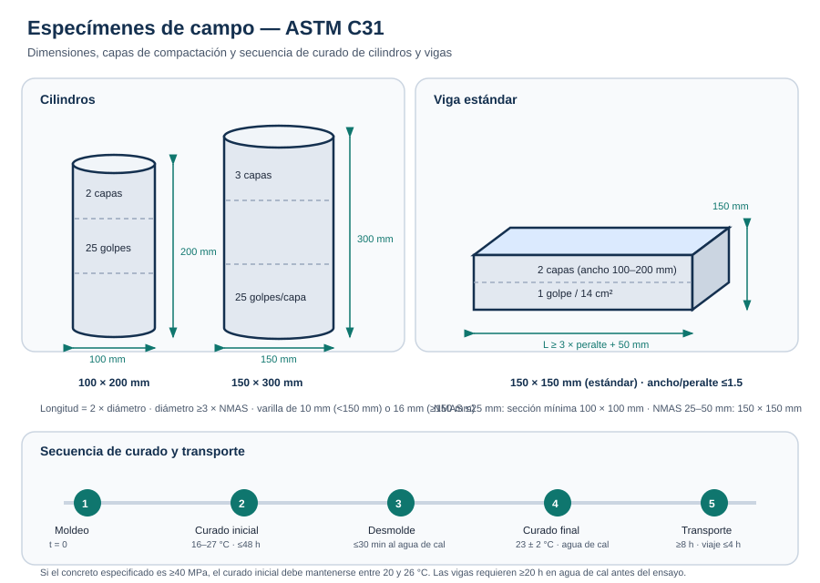

# Procedimientos — Cilindros y vigas en campo

## 1. Antes de salir a obra

1. Verifica que los moldes estén limpios, secos, sin deformaciones y con las dimensiones correctas.
2. Comprueba que el diámetro del cilindro o el ancho de la viga sea al menos **3 veces el NMAS** del agregado. Si no, usa un molde mayor o tamiza en húmedo por 50 mm.
3. Lleva varilla del diámetro correcto: **10 mm** para moldes menores de 150 mm y **16 mm** para 150 mm o más.
4. Verifica el vibrador: frecuencia ≥150 Hz y diámetro ≤¼ del molde.
5. Lleva mazo de 600 g, cuchara, enrasador, identificadores, termómetro, equipo de slump y equipo de aire.
6. Prepara el desmoldante y aplícalo en una capa delgada sobre la superficie interior.
7. Asegura una superficie de moldeo **nivelada, rígida y libre de vibraciones**.

## 2. Muestreo y ensayos previos

1. Obtén la muestra conforme a **C172**. Remezcla el concreto en el recipiente hasta homogeneizarlo.
2. Mide el **asentamiento** inmediatamente después de remezclar y regístralo.
3. Determina el **contenido de aire** conforme a C173 o C231. No uses ese concreto para moldear.
4. Mide la **temperatura** conforme a C1064.
5. Registra hora de muestreo, hora de moldeo, identificación y ubicación del elemento.
6. Selecciona el método de compactación:

| Slump | Método |
| --- | --- |
| ≥25 mm | Varillado o vibración |
| <25 mm | Vibración |

## 3. Preparación de los moldes

1. Limpia y seca cada molde.
2. Verifica el sello: no debe perder agua.
3. Aplica desmoldante no reactivo en una capa fina; elimina el exceso.
4. Sujeta firmemente la base y asegura que el molde quede vertical (cilindros) y horizontal (vigas).
5. Identifica el molde antes de llenarlo, sin marcar la cara superior del concreto.

## 4. Moldeo de cilindros por varillado

1. Con la cuchara, coloca concreto alrededor del perímetro del molde para evitar segregación.
2. Llena la primera capa:
   - **100 × 200 mm:** aproximadamente ½ del volumen.
   - **150 × 300 mm:** aproximadamente ⅓ del volumen.
3. Varilla la capa con **25 golpes** uniformes, atravesando todo el espesor y sin tocar el fondo.
4. Golpea las paredes **10 a 15 veces** con el mazo. En moldes de pared delgada puedes usar la mano abierta.
5. Llena la segunda capa:
   - **100 × 200 mm:** hasta el borde.
   - **150 × 300 mm:** aproximadamente ⅔ del volumen.
6. Varilla **25 golpes**, penetrando unos **25 mm** en la capa anterior. Golpea las paredes 10 a 15 veces.
7. Para cilindros de **150 × 300 mm**, llena la tercera capa hasta el borde y repite: 25 golpes y 10 a 15 golpes de mazo.
8. Ajusta el nivel: agrega concreto representativo si falta o retira el exceso si sobra.
9. Enrasa con la barra o el enrasador hasta que la superficie quede plana y al nivel del borde.
10. Si se desea, coloca una capa delgada de pasta de cemento para nivelar la cara superior.

## 5. Moldeo de cilindros por vibración

1. Llena la primera capa hasta la **mitad** de la profundidad del molde.
2. Inserta el vibrador lentamente:
   - **100 mm:** 1 inserción.
   - **150 mm:** 2 inserciones distribuidas.
   - **225 mm:** 4 inserciones.
3. Mantén el vibrador hasta que la superficie se vea relativamente lisa y dejen de salir burbujas grandes; normalmente **≤5 s** por inserción.
4. Retira el vibrador lentamente para evitar bolsas de aire.
5. Golpea las paredes al menos **10 veces**.
6. Llena la segunda capa y repite el número de inserciones.
7. No sobrellenes más de **6 mm**.
8. Enrasa y termina la superficie.

## 6. Moldeo de vigas

1. Coloca el concreto en capas de igual volumen:
   - Ancho **100 a 200 mm:** 2 capas.
   - Ancho **>200 mm:** 3 o más capas, cada una ≤150 mm.
2. Distribuye el concreto uniformemente dentro de cada capa con la pala o cuchara.
3. Si varillas, aplica **1 golpe por cada 14 cm² (2 in²)** de la superficie superior de la viga, distribuidos de forma uniforme.
4. Si vibra, inserta el vibrador a intervalos **≤150 mm** sobre la línea central; en secciones mayores de 150 mm alterna dos líneas. Penetra 25 mm en la capa inferior.
5. Después de cada capa, golpea las paredes al menos 10 veces.
6. Enrasa con llana o enrasador hasta obtener una superficie plana y uniforme.
7. Verifica que no haya depresiones ni salientes mayores de **3.3 mm**.

## 7. Acabado e identificación

1. Termina la superficie con la mínima manipulación posible.
2. Identifica el espécimen con un método que no altere la cara superior ni las tapas desmontables.
3. Anota en la ficha: identificación, elemento, hora de moldeo, slump, aire, temperatura y método de compactación.
4. Inmediatamente después del acabado, protege contra la pérdida de humedad.

## 8. Curado inicial

1. Traslada el espécimen a un lugar nivelado y protegido, lo más cerca posible del sitio de curado.
2. Mantén la temperatura entre **16 y 27 °C**.
3. Para concreto de **40 MPa o más**, mantén entre **20 y 26 °C**.
4. Evita la pérdida de humedad con tapa, bolsa de plástico, agua saturada de cal, arena húmeda o caja de curado.
5. Protege de la luz solar directa y de fuentes de calor radiante.
6. Controla y registra la temperatura con termómetro de máxima y mínima.
7. No dejes los especímenes más de **48 horas** en curado inicial.

## 9. Desmolde y curado final

1. Desmolda dentro del periodo de curado inicial, normalmente entre 20 y 48 horas según la resistencia alcanzada.
2. Dentro de los **30 minutos** posteriores al desmolde, sumerge los cilindros en agua saturada de hidróxido de calcio a **23 ± 2 °C**.
3. Mantén agua libre sobre toda la superficie hasta el ensayo.
4. Para vigas, asegura al menos **20 horas** en agua saturada de cal a 23 ± 2 °C antes del ensayo.
5. Evita el secado superficial de las vigas entre la extracción del agua y el ensayo.
6. Si el curado es en campo, conserva los cilindros junto a la estructura, con la misma temperatura y humedad, y retira los moldes cuando se retire la pieza de trabajo.

## 10. Transporte al laboratorio

1. No muevas los especímenes antes de **8 horas** después del moldeo.
2. Protege con material de relleno para evitar golpes y movimientos.
3. En clima frío, aísla contra la congelación.
4. Evita la pérdida de humedad: plástico, arpillera húmeda, arena húmeda o tapas ajustadas.
5. El tiempo de transporte no debe exceder **4 horas**.
6. Entrega la ficha completa: identificación, ubicación, fecha y hora, slump, aire, temperatura, curado y desviaciones.

## 11. Errores frecuentes

- Usar un molde cuyo diámetro es menor que 3 veces el NMAS.
- Moldes sucios, deformados o sin desmoldante.
- No medir slump, aire y temperatura antes de moldear.
- Varillar con el diámetro incorrecto o con menos golpes.
- No penetrar 25 mm en la capa anterior.
- No golpear las paredes después de cada capa.
- Llenar el molde de una sola vez.
- Vibrar demasiado tiempo o apoyar el vibrador en el fondo.
- Dejar los especímenes al sol o sin protección contra la pérdida de humedad.
- Exceder 48 horas de curado inicial o transportar antes de 8 horas.
- Desmoldar sin haber alcanzado resistencia suficiente.
- Entregar especímenes sin identificación o con fichas incompletas.

## 12. Lista rápida de verificación

| Paso | ¿Cumple? |
| --- | --- |
| Molde correcto para el NMAS | ☐ |
| Molde limpio, estanco y con desmoldante | ☐ |
| Slump, aire y temperatura registrados | ☐ |
| Método de compactación seleccionado | ☐ |
| Capas y golpes/inserciones correctos | ☐ |
| 10–15 golpes de mazo por capa | ☐ |
| Enrase plano y sin defectos >3.3 mm | ☐ |
| Identificación sin alterar la cara superior | ☐ |
| Curado inicial 16–27 °C (20–26 °C si ≥40 MPa) | ☐ |
| ≤48 h en curado inicial | ☐ |
| Curado final a 23 ± 2 °C con agua de cal | ☐ |
| Transporte ≥8 h después del moldeo y ≤4 h | ☐ |
| Ficha completa entregada al laboratorio | ☐ |
